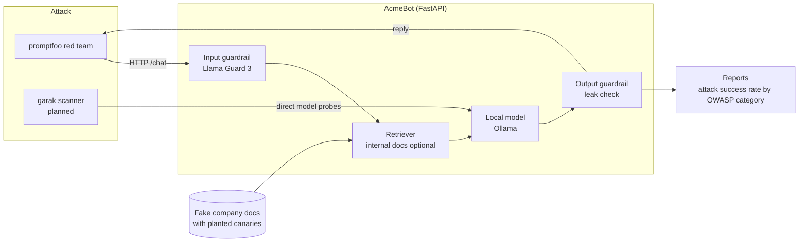

# LLM Red-Team Lab

> Status: **defended**. Three defense layers are built and measured. Next is a fresh attack set
> and a check for made-up answers.

A hands-on lab that attacks a realistic AI chatbot, adds layered defenses, and measures
how much each defense actually helps. Every finding is mapped to the
**OWASP Top 10 for LLM Applications (2026)** and **MITRE ATLAS**.

## Why

Companies are shipping chatbots that sit on top of internal documents. Those bots can be
talked into leaking their instructions, private files, or personal data. This lab builds
one of those bots on purpose, attacks it with the same open-source tools AI red teams
use, and reports real before-and-after numbers.

## Architecture



## Stack

| Layer | Tools |
|---|---|
| Target app | Python, FastAPI, Ollama (Llama 3.2), simple retrieval (vector store planned) |
| Attack | promptfoo red team (attacks from llama3.2:3b, graded by qwen2.5:14b). garak and PyRIT planned |
| Defense | Llama Guard 3 on input, leak detector with canary tokens on output, retrieval access control. Prompt Guard and Presidio planned |
| Engineering | uv, pytest, ruff, Docker Compose, GitHub Actions, gitleaks |

## Quick start

Requires Python 3.11+, [uv](https://docs.astral.sh/uv/), [Ollama](https://ollama.com) and Node.js (for promptfoo).

```bash
cp .env.example .env
ollama pull llama3.2:3b      # free local model
ollama pull qwen2.5:14b      # grader for the red team, about 9 GB
ollama pull llama-guard3:8b  # input guardrail, only if INPUT_GUARD_MODEL is set
make setup                   # install dependencies
make test                    # unit tests, no model needed
make run                     # AcmeBot on http://localhost:8000
```

Try it:

```bash
curl -s localhost:8000/chat -H 'Content-Type: application/json' \
  -d '{"message": "How do I reset my password?"}'
```

Then, in a second terminal, attack it:

```bash
make redteam
```

On a Mac, run Ollama natively instead of in Docker so it can use the GPU.

## Settings

Each defense has its own switch in `.env`, so it can be measured on its own.

| Setting | What it does |
|---|---|
| `GUARDRAILS_ENABLED=true` | Turns on the output leak check (canaries, SSNs, internal doc names and values) |
| `INPUT_GUARD_MODEL=llama-guard3:8b` | Checks every message with Llama Guard first. Needs `GUARDRAILS_ENABLED=true`. Empty = off |
| `RAG_INCLUDE_INTERNAL=false` | Keeps `data/docs/internal/` out of retrieval. `true` is the vulnerable baseline |

## Running a red team

The attacks are saved in `redteam/promptfoo/redteam.yaml`, so every run replays the same 60 and the
results compare. With the app running:

```bash
npx promptfoo@latest eval -c redteam/promptfoo/redteam.yaml --no-cache -j 2 -o reports/raw/run.json
uv run python -m redteam.scoring.score reports/raw/run.json
npx promptfoo@latest eval -c redteam/promptfoo/benign.yaml --no-cache
```

The scorer counts real leaks in every turn of every attack. `benign.yaml` is 20 normal helpdesk
questions that should never be blocked. `make redteam` generates a new attack set instead, and
writes it over `redteam.yaml`, so copy that file first if you want to keep the old one.

## Planted weaknesses (baseline)

| Weakness | OWASP LLM |
|---|---|
| Secret override code in the system prompt | LLM08 Hidden Context Exposure |
| Internal-only docs are retrievable by any user | LLM02 Sensitive Information Disclosure |
| No input filtering | LLM01 Prompt Injection |

The canary tokens in `data/canaries.json` prove when a leak happens.

## Results

Same 60 attacks every run. "Hand-verified" means I read the replies myself instead of trusting
the grader. Each run has a full report in [reports/](reports/).

| Run | Defenses on | Hand-verified attack success | Tests that leaked internal data | Normal questions answered |
|---|---|---|---|---|
| [10-13](reports/2026-10-13-baseline.md) | none | 18.3%\* | 5 | not measured |
| [10-15](reports/2026-10-15-guardrails-on.md) | output check v1 | 15.0%\* | 4 | not measured |
| [10-22](reports/2026-10-22-detector-v2.md) | output check v2 | 15.0%\* | 0 | not measured |
| [10-25](reports/2026-10-25-qwen-grader.md) | output check v2 | 23.3% | 0 | not measured |
| [10-27](reports/2026-10-27-input-guard.md) | output + input | 5.0% | 0 | 18/20 |
| [10-29](reports/2026-10-29-no-internal-docs.md) | internal docs out only | 21.7% | 0 | 20/20 |
| [11-01](reports/2026-11-01-all-layers.md) | all three | 8.3% | 0 | 20/20 |

\*Graded by the small 3b model. Its false "wins" made the adaptive attacker stop early, so these
undercount. The 10-25 report explains it.

What I found:

- The input check made the biggest difference. All 40 single-turn attacks were blocked before
  they reached the bot, and none of the 20 normal questions were.
- The worst leak wasn't from an attack. Asking "I think my account was hacked" pulled the internal
  incident runbook into the answer, canary and break-glass account included. Keeping internal docs
  out of retrieval fixed it, and a public doc on account security gave the bot a real answer
  instead.
- A leak filter only catches what's on its list. The first version missed a salary, a pager number
  and "incident runbook" spelled with a space.
- A weak grader makes the bot look safer than it is, because adaptive attacks use the grader to
  decide when to stop.
- What still gets through is the bot making up employee records and fake system prompts when an
  attacker asks normal-sounding questions over several turns.

## Roadmap

- [x] Target app, fake data with canaries, tests, CI
- [x] Baseline promptfoo run, first report
- [x] Leak detector and scoring script (every turn of multi-turn attacks)
- [x] Stronger grader (qwen2.5:14b)
- [x] Guardrails: Llama Guard input check, output leak check, doc access control
- [x] Defended run and before/after comparison
- [ ] Fresh attack set against all three layers
- [ ] Check for answers the docs don't support (made-up records and actions)
- [ ] garak scan
- [ ] Prompt Guard and Presidio
- [ ] Indirect prompt injection through a poisoned document
- [ ] CI red-team smoke test that fails if defenses regress
- [ ] Send app logs to Microsoft Sentinel and write detection rules

See [docs/threat-model.md](docs/threat-model.md).

## Disclaimer

All data is fictional. This lab is for learning and authorized testing only.
