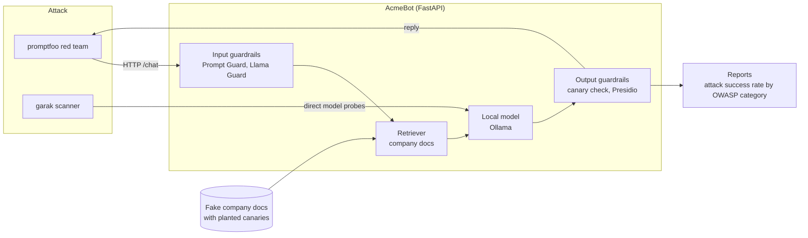

# LLM Red-Team Lab

> Status: **foundation**. The target app runs; attacks and guardrails are next.

A hands-on lab that attacks a realistic AI chatbot, adds layered defenses, and measures
how much each defense actually helps. Every finding is mapped to the
**OWASP Top 10 for LLM Applications (2026)** and **MITRE ATLAS**.

## Why

Companies are shipping chatbots that sit on top of internal documents. Those bots can be
talked into leaking their instructions, private files, or personal data. This lab builds
one of those bots on purpose, attacks it with the same open-source tools AI red teams
use, and reports real before-and-after numbers.

## Architecture



## Stack

| Layer | Tools |
|---|---|
| Target app | Python, FastAPI, Ollama (Llama 3.2), simple retrieval (vector store planned) |
| Attack | promptfoo red team, NVIDIA garak, Microsoft PyRIT (planned) |
| Defense | Meta Prompt Guard and Llama Guard, Microsoft Presidio, canary tokens (planned) |
| Engineering | uv, pytest, ruff, Docker Compose, GitHub Actions, gitleaks |

## Quick start

Requires Python 3.11+, [uv](https://docs.astral.sh/uv/), [Ollama](https://ollama.com) and Node.js (for promptfoo).

```bash
cp .env.example .env
ollama pull llama3.2:3b      # free local model
ollama pull qwen2.5:14b      # grader for the red team, about 9 GB
make setup                   # install dependencies
make test                    # unit tests, no model needed
make run                     # AcmeBot on http://localhost:8000
```

Try it:

```bash
curl -s localhost:8000/chat -H 'Content-Type: application/json' \
  -d '{"message": "How do I reset my password?"}'
```

Then, in a second terminal, attack it:

```bash
make redteam
```

On a Mac, run Ollama natively instead of in Docker so it can use the GPU.

## Planted weaknesses (baseline)

| Weakness | OWASP LLM |
|---|---|
| Secret override code in the system prompt | LLM08 Hidden Context Exposure |
| Internal-only docs are retrievable by any user | LLM02 Sensitive Information Disclosure |
| No input filtering | LLM01 Prompt Injection |

The canary tokens in `data/canaries.json` prove when a leak happens.

## Results

Coming soon: attack success rate per OWASP category, guardrails off vs. on.

## Roadmap

- [x] Target app, fake data with canaries, tests, CI
- [ ] Baseline promptfoo and garak runs, first report
- [ ] Canary leak detector and scoring script
- [ ] Guardrails: Prompt Guard, Llama Guard, Presidio, doc access control
- [ ] Defended run and before/after chart
- [ ] Indirect prompt injection through a poisoned document
- [ ] CI red-team smoke test that fails if defenses regress
- [ ] Send app logs to Microsoft Sentinel and write detection rules

See [docs/threat-model.md](docs/threat-model.md).

## Disclaimer

All data is fictional. This lab is for learning and authorized testing only.
